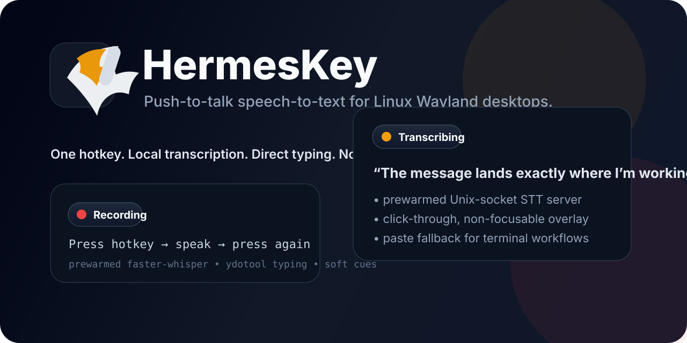

# HermesKey

<p align="center">
  
</p>

<p align="center">
  <a href="https://github.com/graygarbage/HermesKey/actions/workflows/ci.yml"></a>
  <a href="https://github.com/graygarbage/HermesKey/releases"></a>
  <a href="LICENSE"></a>
  
  
</p>

**HermesKey** is a **push-to-talk speech-to-text weapon** for Linux Wayland desktops.

You press one hotkey, speak, press it again, and your words land back in the active app with almost no ceremony:

- no cloud account
- no subscription nonsense
- no giant Electron slab
- no mouse required
- no repeated model warm-up penalty

It is local-first, fast, and built for people who want voice dictation to feel like a native part of their desktop instead of a science project.

---

## Why it rules

- **One-key toggle** for start/stop recording
- **Prewarmed `faster-whisper` server** for low-latency transcription
- **Direct typing into the active app**
- **Clipboard backup** so your words are never stranded
- **Paste fallback for terminals** and terminal-like apps
- **Click-through overlay** for clean `Recording` / `Transcribing` status
- **Soft audio cues** instead of painful beeps
- **Wayland-friendly typing** via a **user-owned `ydotoold` service**
- **Built-in doctor command** for fast troubleshooting
- **Config file, systemd services, docs, CI, release packaging**

---

## The workflow

<p align="center">
  
</p>

HermesKey was built for this exact loop:

1. hit your hotkey
2. talk
3. hit the same hotkey again
4. keep moving

No modal UI. No giant dashboard. No focus theft.

---

## Why “HermesKey”?

**Hermes** is the messenger god in Greek mythology: fast, precise, always carrying the message.

That is exactly what this tool should feel like.

---

## Current target environment

HermesKey is currently tuned and tested primarily for:

- **Linux**
- **Wayland**
- **KDE Plasma**
- **PipeWire / PulseAudio-compatible audio**

It may work elsewhere, but KDE Wayland is the first-class target for now.

---

## Quick start

### 1. Install system dependencies

Typical requirements:

- `ffmpeg`
- `wl-clipboard`
- `libnotify` / `notify-send`
- `ydotool`
- `python3`
- `python3-pip`
- `python3-venv`
- `PySide6` runtime support
- `qdbus` on KDE
- `paplay`

Detailed distro guidance lives in [docs/INSTALL.md](docs/INSTALL.md).

### 2. Create the Python environment

```bash
python3 -m venv ~/venvs/stt
source ~/venvs/stt/bin/activate
pip install -U pip
pip install -r requirements.txt
```

### 3. Install HermesKey

```bash
chmod +x install.sh
./install.sh
```

### 4. Bind your desktop hotkey

Point your desktop shortcut at:

```bash
~/.local/bin/hermeskey
```

### 5. Dictate

- press once → recording starts
- press again → recording stops and transcribes
- HermesKey copies to clipboard and types into the active app

---

## Architecture

HermesKey is intentionally small and understandable.

### `bin/hermeskey`
Main hotkey entrypoint.

Responsibilities:
- audio capture
- overlay control
- soft tones
- server communication
- clipboard backup
- typing / paste fallback

### `bin/hermeskey-server.py`
Long-lived local transcription server over a Unix domain socket.

This is the piece that keeps Whisper **warm** so you do not pay startup cost every time you speak.

### `bin/hermeskey-overlay.py`
Minimal overlay process.

It is designed to be:
- non-focusable
- click-through
- visually clear

More technical detail:

- [docs/ARCHITECTURE.md](docs/ARCHITECTURE.md)
- [docs/CONFIGURATION.md](docs/CONFIGURATION.md)
- [docs/TROUBLESHOOTING.md](docs/TROUBLESHOOTING.md)
- [docs/FAQ.md](docs/FAQ.md)

---

## Installation layout

`install.sh` installs:

- `~/.local/bin/hermeskey`
- `~/.local/bin/hermeskey-server.py`
- `~/.local/bin/hermeskey-overlay.py`
- `~/.local/bin/hermeskey-doctor`
- `~/.config/systemd/user/hermeskey.service`
- `~/.config/systemd/user/hermeskey-ydotoold.service`
- `~/.config/hermeskey/hermeskey.env`
- `~/.config/hermeskey/hermeskey.env.example`

It also creates compatibility symlinks for the earlier `ptt_stt_*` names.

---

## Configuration

HermesKey reads config from:

```bash
~/.config/hermeskey/hermeskey.env
```

Example:

```bash
MODEL=medium
STT_LANG=en
RECORD_SOURCE=alsa_input.usb-Beyerdynamic_FOX_5.00-00.mono-fallback
INSERT_MODE=type
COPY_TO_CLIPBOARD=1
OVERLAY_ENABLED=1
SOUND_ENABLED=1
FOCUS_SAFE_MODE=0
```

Sound tuning:

```bash
START_TONE_HZ=660
STOP_TONE_HZ=520
TONE_DURATION=0.035
TONE_VOLUME=0.20
```

Typing / paste behavior:

```bash
TYPE_BACKEND=auto
PASTE_SHORTCUT=auto
TERMINAL_APPS=org.wezfurlong.wezterm,org.kde.konsole,kitty,Alacritty,ghostty,foot,gnome-terminal,tilix,xfce4-terminal
PASTE_FOR_APPS=$TERMINAL_APPS
```

More detail:
- [docs/CONFIGURATION.md](docs/CONFIGURATION.md)

---

## Services

Restart the transcription server:

```bash
systemctl --user restart hermeskey.service
```

Restart the typing daemon:

```bash
systemctl --user restart hermeskey-ydotoold.service
```

Check status:

```bash
systemctl --user status hermeskey.service
systemctl --user status hermeskey-ydotoold.service
```

---

## Doctor mode

Run a quick environment and service audit:

```bash
hermeskey-doctor
```

This checks core commands, services, sockets, and audio sources.

---

## Logs

```bash
tail -f /tmp/hermeskey.log
journalctl --user -u hermeskey.service -f
journalctl --user -u hermeskey-ydotoold.service -f
```

---

## Development

Run local checks:

```bash
make check
```

Or manually:

```bash
bash -n bin/hermeskey install.sh uninstall.sh
python3 -m py_compile bin/hermeskey-server.py bin/hermeskey-overlay.py
```

Build a release tarball:

```bash
make package
```

---

## Roadmap

- richer per-app configuration
- packaged releases for common distros
- improved compositor detection outside KDE
- optional GUI configuration surface
- prettier branding and demo media

---

## Contributing

PRs, bug reports, and focused improvements are welcome.

Read:

- [CONTRIBUTING.md](CONTRIBUTING.md)
- [CODE_OF_CONDUCT.md](CODE_OF_CONDUCT.md)
- [SECURITY.md](SECURITY.md)
- [SUPPORT.md](SUPPORT.md)

---

## License

MIT — see [LICENSE](LICENSE).
